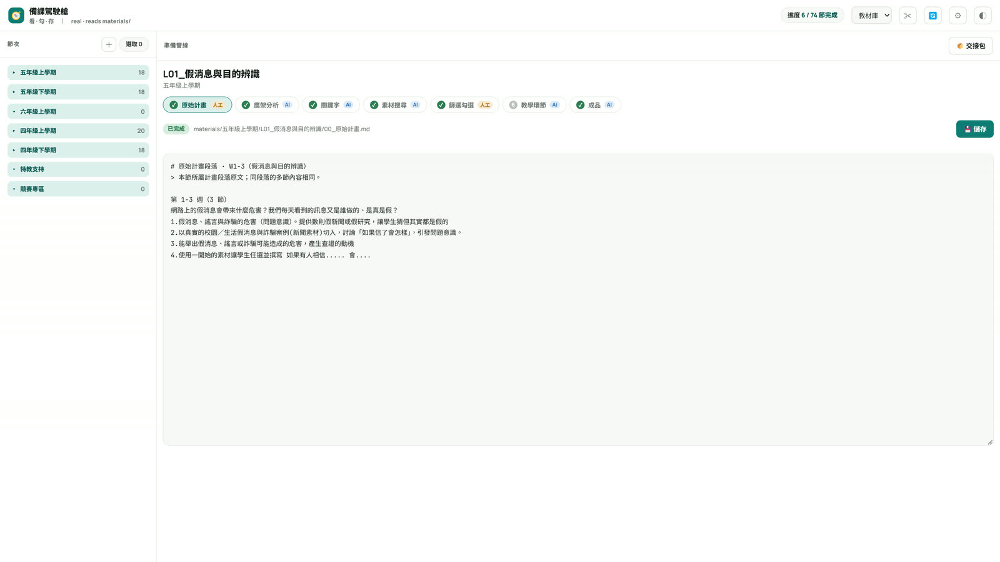
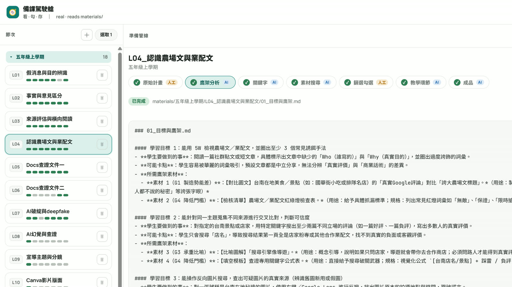
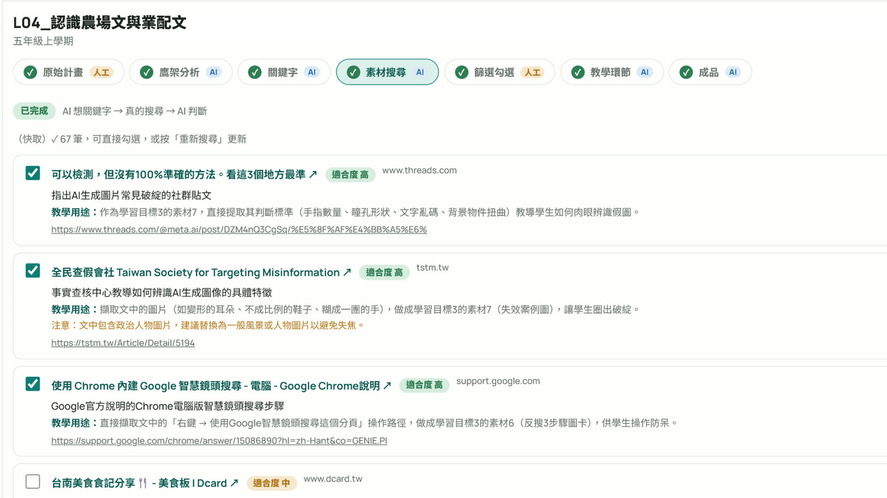
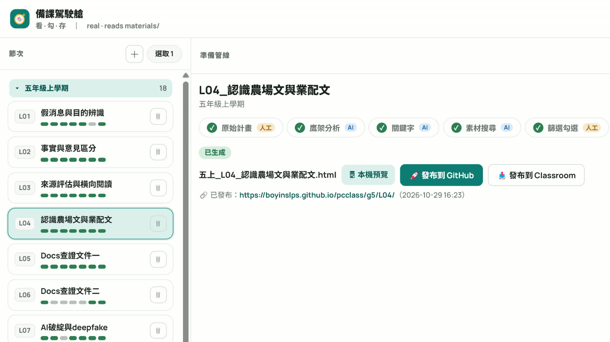

# 備課平台（lesson-prep）

<p align="center">
  <a href="https://boyinslps.github.io/platform-guide/docs/media">
    
  </a>
  <br>
  <sub>點圖看 40 秒介紹影片</sub>
</p>

依教師個人教學風格，半自動產出教案、簡報與互動學習單的本機工作流。
純 Python 標準庫寫成的本機伺服器（**不需要 pip、不需要 Node**），瀏覽器當介面。

<p align="center">
  <a href="https://boyinslps.github.io/platform-guide/"><b>📖 專案導覽站</b></a> ·
  <a href="https://boyinslps.github.io/platform-guide/docs/prep">備課平台介紹</a> ·
  <a href="https://boyinslps.github.io/platform-guide/docs/media">🎬 介紹影片</a> ·
  <a href="https://boyinslps.github.io/platform-guide/docs/roadmap">未來規劃</a>
</p>

> 姊妹專案：[grading-platform](https://github.com/boyinslps/grading-platform)（評分平台，負責收學習單繳交與算成績）。
> 兩邊各自獨立安裝、各自更新，只有「學習單產出 → 學生繳交」這條資料流相連。

## 畫面導覽

備課駕駛艙：左邊是各學期節次，中間是 6 階段管線，每階段標示由 **AI** 或**人工**完成。

<p align="center"></p>

| 推導鷹架 | 素材搜尋＋適合度判斷 | 成品：預覽 → 發布 |
|---|---|---|
|  |  |  |

**核心理念**：每個階段都是資料夾裡的一個檔案（可回溯、可重跑）；該由人決定的地方——選關鍵字、勾素材、確認流程、迭代成品——都停下來讓老師審核。

---

## 這是什麼

| 資料夾 | 內容 |
|---|---|
| `工作台/` | 本機伺服器（`server.py`，port 8770）與面板（`web/index.html`） |
| `materials/` | 各學期各節次的教材產出（7 階段管線：原始計畫 → 鷹架 → 關鍵字 → 素材 → 篩選 → 教學環節 → 成品） |
| `引導規範/` | **這套系統的核心**：教學活動設計、簡報設計、互動教材、學習單資料契約、AI 評分、自動更新等規範 |
| `課程計畫/` | 各年級彈性學習課程計畫 |
| （獨立專案）`D:/claude 工作區/win11-sim/` | 教學用模擬 Windows 11／Google 文件資料包，**不在本 repo**；技能闖關、上課影片用它。AI 先讀該專案的 `AI說明.md` |

管線的每個階段都是資料夾裡的一個檔案，面板負責「看 · 勾 · 存」，AI（Claude Code／Gemini）負責生成，
**檔案就是兩者之間的橋**。

---

## 安裝

> ⚠️ **請用 `git clone`，不要用「Download ZIP」**——ZIP 裝出來的不是 git 工作區，之後不能自動更新。

```bash
git clone https://github.com/boyinslps/lesson-prep.git
```

接著補上兩個**不在 git 裡**的東西（每台電腦各自準備）：

1. **可攜式 Python**：把 `工作台/runtime/` 整個資料夾從既有的安裝複製過來
   （這台電腦沒有系統 Python 也能跑，所以用可攜版；體積大所以不進 git）。
2. **`工作台/config.json`**：第一次啟動後會自動產生，再到面板的「設定」填 AI 金鑰與 Google OAuth。
   **這個檔含金鑰，永遠不會被 commit。**

## 啟動

雙擊 `工作台/啟動工作台.bat`，瀏覽器會開 <http://127.0.0.1:8770>。
關掉那個黑色視窗就是關掉伺服器。

---

## 自動更新

作者在自己的電腦改完 push 上來之後，**其他安裝端一開啟面板就會看到藍色橫幅**：

> 🔔 有新版本可以更新：1.0.0 → 1.0.1（3 個更新）　[更新內容] [立即更新] [稍後]

按「立即更新」就會 `git merge --ff-only` 拉到最新版，完成後**要關掉視窗重新啟動**（執行中的還是舊的 server.py）。

- 更新**只做快轉**，絕不在你的電腦上跳合併衝突。
- 這台電腦自己的東西（`config.json`、`runtime/`、課表、任何學生資料）都在 `.gitignore` 裡，
  所以更新不會蓋掉你的設定。
- 反過來說：**不要自己 commit 修改到這個工作區**，否則那台電腦會再也無法快轉更新。
  要改功能請在作者端改、push 上來，大家一起更新。

機制全文見 [`引導規範/自動更新規範.md`](引導規範/自動更新規範.md)。

---

## 發布新版（作者端）

```bash
# 改完東西，視情況更新 VERSION
git add -A && git commit -m "說明這次改了什麼" && git push
```

commit 訊息會**直接變成其他人看到的更新說明**，所以要寫人看得懂的話
（寫「修正繳交後不會跳出獎勵區塊」，不要寫 `fix bug`）。

---

made by 資訊老師黃博胤
