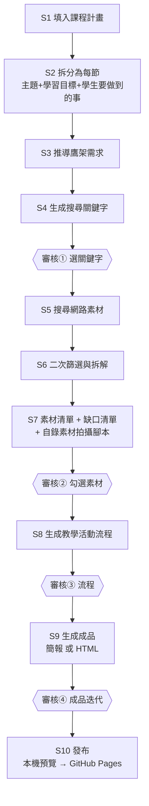

# 工作流程規範（從課程計畫到成品教材）

> 其他規範談「**怎麼設計**」（引導邏輯、簡報、HTML 互動教材、學習單資料）；**這份談「怎麼跑」**——
> 從一份課程計畫出發，一路走到可上課、可發布的簡報或 HTML 互動教材。
>
> **三條總原則**
> 1. **全程以課程計畫與既有教學證據為依據**：每個階段都先讀課程計畫對應段落與前一階段產出，不憑空發揮。
> 2. **每階段產出「檔案」**：結果寫成檔案落地，可回溯、可重跑、可比較；檔案存在與否就是進度。
> 3. **該由人決定的地方停下來**：選關鍵字、勾素材、確認流程、迭代成品都要等老師；面板負責「看 · 勾 · 存」，生成交給 AI（工作台的 Gemini 或 Claude Code）。

---

## 1. 流程總覽（10 階段 · 4 個審核點）



可一次指定多節（「跑第 5、6、7 節」）批次走 S3–S9。

---

## 2. 檔案與資料夾約定

每一節一個資料夾，階段產出依序編號落地——**檔名即流程進度**。

```
materials/
└── 五年級上學期/                         # 學期群組（面板左側的分組）
    ├── 課程計畫/課程計畫.md              # S1：整份計畫原文
    └── L05_地圖街景找障礙/               # S2：一節一個資料夾
        ├── 00_原始計畫.md                # S2：這節所屬的計畫段落原文
        ├── 01_目標與鷹架.md              # S3
        ├── 02_搜尋關鍵字.md              # S4 → 審核①
        ├── 03_素材候選.md（＋.json 快取） # S5–S6
        ├── 04_素材清單與缺口.md          # S7 → 審核②（含拍攝腳本）
        ├── 05_教學活動流程.md            # S8 → 審核③
        ├── 五上_L05_地圖街景找障礙.html   # S9 → 審核④（命名見 S9）
        └── assets/                        # 圖片、影片、出處清單
```
- 不是每節都要走滿 01～05：操作型、沿用既有教材的節次可以直接做成品，但成品仍放在同一個資料夾。
- 成品用 Python 腳本產生的（如五上 L05 週五版），腳本與共用引擎放在群組底下的 `_build_*` 資料夾，**改內容要改腳本再重新產生**，不要直接改 HTML。

**`L##` 的編號＝第幾週上這節課**。下游有兩個工具直接依賴它：
| 依賴的地方 | 怎麼用 |
|---|---|
| 工作台「發布到 Classroom」→「問題」 | 自動帶出標題 `第{X}週 {單元名稱}`，X＝`L##` |
| 評分平台「回寫 Classroom」 | 從學習單的 `L##` 反推週次，找標題「第X週…」的作業寫成績 |

- 計畫切分（S2）是**依序**編 `L01、L02…`；跟實際週次不同時（跳週、補課、調課）要改資料夾編號，讓**資料夾與 Classroom 標題兩邊一致**。
- 真的必須脫鉤時（同一週上兩節），回寫畫面可以手動改選作業，但預設比對會失準。

---

## 3. 逐階段規格

### S1　填入課程計畫
- **輸入**：課程計畫（`.docx`／`.pdf`／`.md`／貼上文字）。工作台「計畫切分」可直接匯入檔案。
- **要求**：解析出專題名稱／驅動問題／課程目標／表現任務／6P 脈絡／逐週的單元問題・學習內容・目標・活動・任務・資源。

#### S1.1　核對既有教學證據（必做）
計畫是骨架，真正的教學設計活在課堂裡；只讀計畫會漏掉「計畫外但實際教過」的單元（例如帳號環境建置、新工具）。
- **動筆前先查**：這個專題／年級是否已有既有簡報、教材、`教學風格分析.md`、`materials/` 下同專題其他節次？有就必讀。
- **比對三件事**：①計畫外新增的單元；②計畫寫了但未實施的（以實際教過的為準）；③既有教材裡的口訣、比喻、標註手法（優先沿用）。
- **沒有既有證據時**明講「以下為依課程計畫與引導邏輯推論」；S2 用一欄標註 `依計畫推論`／`依實證還原`／`計畫外新增`。

### S2　拆分為每節
- 計畫多以「第 2-4 週」區間書寫，要依「認知上非跨不可的坎」拆成獨立節次（勿平均切）。
- 每節定出：本節主題｜對應週次｜學習目標｜**學生要做到的事**（可觀察、可檢核的行為，不用「了解／認識」）｜6P 階段｜建議語域。
- **產出**：各節資料夾＋`00_原始計畫.md`（工作台「計畫切分」自動建立）。

#### S2.0　切分顆粒度：盡量切小
- **一節只引入 1–2 個新概念或工具操作**；一個工具的多步操作拆成好幾節。
- 參考節數（下限錨點，不是上限）：文書／簡報／Canva 類約 3–4 節；Scratch 類約 5 節；影片／網站製作約 2–3 節；選題／發表／反思約 1–2 節。
- 判準：這節結束時每個人是否只跨了一小步？

#### S2.1　節數現實校準（必做）
- 計畫節數是名目值，實際約打 8 折（宣導、活動、假日會吃掉）。**以實際值排課。**
- 學生製作速度要保守估計，**寧可少排，不要排滿**。
- 發表節常被吃掉：**不要把關鍵學習綁在發表節**；展示與回饋改用隨堂互玩、走動觀摩、線上互評這類低成本形式。
- **最優先保護最終作品的製作時間**：要砍先砍手段類節次與正式發表節。
- 節次每列標 `核心必達`／`可壓縮`／`可合併`，並寫出「若少 N 節，先合併哪幾節」。

#### S2.2　累積型專題（如 Scratch）改用「逆向拆解」
一個作品逐節長出來的專題，概念有嚴格的依賴順序，要先有完成品再回頭拆：
1. **匯入範本**：老師給一個完成品（`.sb3` 或分享連結）＝學生的完成目標。
2. **概念清點**：列出完成品用到的每個概念／積木（事件、座標、變數、條件、迴圈、廣播、初始化…）。
3. **難度＋依賴排序**（〔例〕座標→移動→碰撞→變數→計分）。
4. **分配到節次**：一節只引入 1–2 個新概念。
5. **每節都有可運行的里程碑**：每節結束時專案都能跑、且比上一節多一個看得見的功能。
6. 每節照常走 S3→S9，**範本全程當北極星**。產出一份逆向拆解文件（概念清點＋依賴＋節次分配＋里程碑）放在群組資料夾。

#### S2.3　不預留測試／回饋節（累積型專題）
- 測試與除錯融進每一節的收尾，不設專門節次；省下的節數平均回填給教學。
- 只保留最末一節「互玩＋定稿」作為收束。

#### S2.4　每節只掛「相關的」計畫段落
- 計畫以週次標頭分段（`第1-3週` → 代碼 `W1-3`）。切分時 AI **只回答每節屬於哪一段**（`section`），原文由系統依標頭切出，AI 不改寫。
- 每節的 `00_原始計畫.md`＝其段落原文；同段落的多節內容相同；跨兩段時取聯集。
- 切分回傳格式：
```json
{
  "sections": [{"code":"W1-3","label":"第1-3週","anchor":"（該段開頭 8-15 字，供系統定位）"}],
  "lessons": [{"id":"L01","title":"假消息與目的辨識","lv1":"能舉出…","section":"W1-3"}]
}
```

### S3　推導鷹架需求
- **核心提問**：學生要做到這件事，中間會卡在哪？卡住的地方需要什麼東西扶他一把？
- 用《教學活動設計規範》的操作子反查需要的素材型鷹架：

  | 需要的引導 | 對應鷹架素材 |
  |---|---|
  | G1 製造勢能差 | 對比圖／衝擊案例照／短影片片段 |
  | G3 承重比喻 | 比喻圖解、可操作演示 |
  | G4 降低門檻 | 半成品檔、填空模板、選單清單、示範影片 |
  | G6 預測—驗證 | 可暫停的示範影片、錯誤範例 |
  | G8 給界線 | 失效案例（如 AI 幻覺實例）、紅綠燈對照 |
- **產出 `01_目標與鷹架.md`**：逐條列「學習目標 → 學生要做到 → 可能卡點 → 所需鷹架素材（型別＋用途＋規格）」。

### S4　生成搜尋關鍵字 → 【審核①】
- **產出 `02_搜尋關鍵字.md`**：每個素材需求 3–5 組關鍵字，含中文、英文與站內限定式（`site:youtube.com`、`site:edu.tw`），標明各組想找到什麼。
- **審核①**：老師選用、補上自訂關鍵字後才進 S5。

### S5　搜尋網路素材
> **鐵則：網址只能來自真實搜尋結果，不能來自 AI 的記憶。** 工作台的 AI 沒有上網能力，叫它給網址一定是編的（實測會回 404 的假網址）。

```
02 關鍵字 → AI 產生查詢字串 → Tavily 真的搜 → 爬回內容 → AI 判讀真實內容 → 03 候選（可點連結）
```
- **AI 做**：想查詢字串、讀抓回來的真實內容判斷適合度與用途。**AI 不准做**：生網址——03 裡每一條網址都必須對應某次搜尋結果。
- **實作**：`工作台/server.py` 的 `material_search()`；金鑰在 ⚙ 設定「素材搜尋（Tavily）」。搜尋結果存成 `03_素材候選.json` 快取，打開時只讀快取，要重搜得自己按；先對教學站白名單站內搜，再全網補足。
- **素材政策**
  - **影片**：不下載，只記 `網址＋起訖時間碼＋這段在講什麼＋用途`。簡報裡放一頁只有標題的佔位頁（「播放：○○ 0:12–0:52」），由老師課堂直接播。
  - **圖片／網頁段落**：依教學合理使用下載存 `assets/`。**簡報用 NotebookLM 生成時，每張圖都要是本機檔案**（NotebookLM 不吃外部連結圖片）。
  - **一律記錄出處**，並標 `課堂用` 或 `可公開`；成品要公開發布時，課堂用素材換成連結或開放授權素材。

### S6　二次篩選與拆解
- 素材很少整份可用，要拆到「可用的那一段」：網頁取段落、影片取起訖秒數、新聞取一段或一張圖、他人教案只取一個活動點子。
- **判準**：①真的對應某個鷹架需求；②在地、貼近學生經驗；③語言與難度適合；④授權與使用範圍。
- **篩選介面**：每筆都能直接點開原始網站，顯示內容簡述、教學用途、AI 判的適合度（高者預設勾選）——讓老師看原始頁面做最後判斷。

### S7　素材清單 + 缺口清單 → 【審核②】
- **產出 `04_素材清單與缺口.md`**：
  1. **可用素材清單**：`編號｜型別｜來源｜可用片段｜對應鷹架｜使用範圍`。
  2. **缺口**：網路找不到、必須自製的（老師錄的操作示範影片、校園實拍、班級專屬半成品）。每個缺口附**拍攝／製作腳本**：畫面、分段、旁白、時長、注意事項。操作示範影片**一個操作錄成一支完整的**（從開始到完成），供成品直接當「老師示範」用。
- **審核②**：老師指定採用、剔除、補充哪些。

### S8　生成教學活動流程 → 【審核③】
- **依據**：`01_目標與鷹架.md`＋`04_素材清單與缺口.md`＋《教學活動設計規範》。
- **產出 `05_教學活動流程.md`**：用功能位置（開場、承接、解密、定向、示範、挑戰、任務、收束）鋪成一節課，**每一段標明用到哪個素材編號**；含單元任務、繳交前自我檢查、通關條件。設計取捨與給老師的說明也寫在這裡（不寫進學生頁面）。
- **完成標準分級只用於創作型任務**：每人成品不同（如 Scratch 作品）→ `LV1 標準／LV2 進階／LV3 挑戰`；全班照步驟做出一樣成品的操作型 → 只設一個「全班都要到」的標準。判斷：這節結束時，每個人的成品會不會長得不一樣？
- **做不完的退路**：標明哪一段可移到下節，並確保只完成 LV1 也接得下去。
- **範本（exemplar）**：一份完成範例對任何單元都有用——它是學生完成目標的具象化。有範本時當北極星（鷹架問「離範本還差哪一塊」、通關條件對照範本）；沒有時可先生成一份範本，經老師確認後再當依據。

### S9　生成成品 → 【審核④】
- **載體建議**：有值得反覆試、需即時回饋、可個人化的環節 → **HTML 互動教材**；純線性講述 → **簡報**。附理由讓老師拍板。
- **生成**：依《簡報設計規範》或《HTML互動教材設計規範》的兩段式生成＋五軸控制；學生要一欄一欄寫出產出的學習單用 HTML 規範 §5.16 的課本式引導；有繳交的照《學習單資料與提交規範》。
- **★ 素材使用對帳（必做）**：成品完成前列表核對 **S7 採用的每一項素材 → 用在成品哪裡**，結果只能是 `已嵌入`／`待補佔位`／`刻意不用（附理由）`。不允許素材列了卻靜默消失。
- **成品檔名**：`{年級簡稱}_{節次資料夾名}.html`（〔例〕`四上_L02_景點選定與資料蒐集.html`）。年級簡稱＝群組名第一字＋上／下。面板把「不是以 `00_`～`05_` 開頭」的檔案認成成品，所以檔名不可用兩位數字加底線開頭；`.md`（簡報頁面清單）同理。

### S10　發布：本機預覽 → GitHub Pages
- **① 本機預覽（先）**：工作台成品區「本機預覽」用本機伺服器開成品檔，相對路徑的 `assets/` 正常載入。**先在這裡驗收互動與素材。**
- **② 發布 GitHub（後）**：「發布到 GitHub」把 `index.html＋assets/` 推上 `boyinslps/pcclass` 的 `g{年級碼}/L##/`，網址自動存回 `materials/_layout.json` 的 `published`，面板該節成品區直接顯示。
- 年級碼、儲存庫結構、SSH、`.gitignore`、Firebase 授權網域等細節 → 《互動教材進階規範》§5。
- 簡報走 Classroom／Drive（工作台「發布到 Classroom」）。

#### S10-b　發布本週的 Classroom 簽到題（成績的落點）
- **一週只開一份「簽到」問題**，該週所有學習單的成績都回寫到那一份，不要每份學習單各開一份作業（動態時報會被洗版、成績也散開）。
- **建立**：工作台成品區「發布到 Classroom」→ 類型「問題」→ 自動套標題 `第{X}週 {單元名稱}`、選項「簽到」。
- **回寫**：評分平台「回寫 Classroom」先找標題「第X週」開頭的作業；找不到才退回用學習單標題比對，再不行才提議建新作業。
- **已知限制**：Classroom 作業一發布就一定會出現在動態時報並通知學生，沒有「安靜發布」；同一份簽到題只建立一次，所以每週只會出現一次。

---

## 4. 各階段指令的共同要求
- **必讀來源**：課程計畫（檔名＋週次）、本節前一階段的產出。不得跳過課程計畫憑空生成。
- **在地化**：例子優先用臺南／該校周遭的真實場景。
- **落地為檔案**：寫入 `materials/<群組>/<節次>/` 對應檔名，不只回在對話。
- **審核點停下來**：走到審核點就停，等老師回覆再繼續。

---

## 5. 流程自檢
- 每一節的「學生要做到的事」是**可觀察行為**嗎？
- 每個鷹架需求都是從**卡點**推出來的，還是先看到素材才反推？每筆素材都對應到某個鷹架需求嗎？
- 03 裡每一條網址都來自真實搜尋結果嗎？影片只記連結＋時間碼？素材都記了出處與使用範圍？
- 缺口素材附了可直接照做的拍攝腳本嗎？
- 教學流程每一段都標了用到哪個素材編號嗎？
- **S7 採用的素材，成品裡真的用到了嗎？**（做過素材使用對帳嗎？）
- 成品載體的建議有附理由嗎？
- **`L##` 跟實際週次對得起來嗎？**（Classroom 簽到題與成績回寫都靠它）
- 四個審核點都真的停下來等老師了嗎？

---

### 延伸
- 怎麼設計引導 → `教學活動設計規範.md`
- 怎麼變成簡報 → `簡報設計規範.md`
- 怎麼變成互動網頁（含逐欄寫作的課本式引導 §5.16）→ `HTML互動教材設計規範.md`
- 雙模式／即時同步／真實素材／發布細節 → `互動教材進階規範.md`
- 識別列／題型標註／繳交資料契約 → `學習單資料與提交規範.md`
- 面板如何呈現這些檔案 → `工作流介面規劃.md`
- 風格證據 → `../教學風格分析.md`
